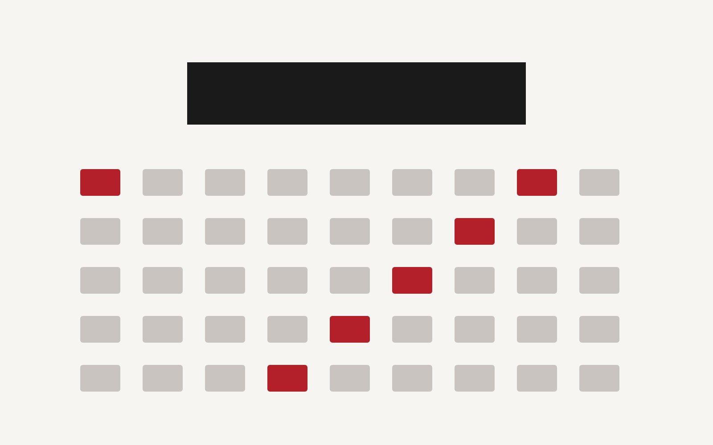

A member of Est Rouge will speak at Web Production Conference 2026, held in November 2026.

## Session overview

| Item | Details |
| --- | --- |
| Topic | Automating content workflows with static site generators and AI |
| Date | Saturday, November 14, 2026, 14:00–14:40 JST |
| Venue | Tokyo (also streamed online) |

With live demos, we will introduce Markdown-based content management and type-safe schema design. We look forward to seeing you there.

*This article is a sample created for technical evaluation.*
