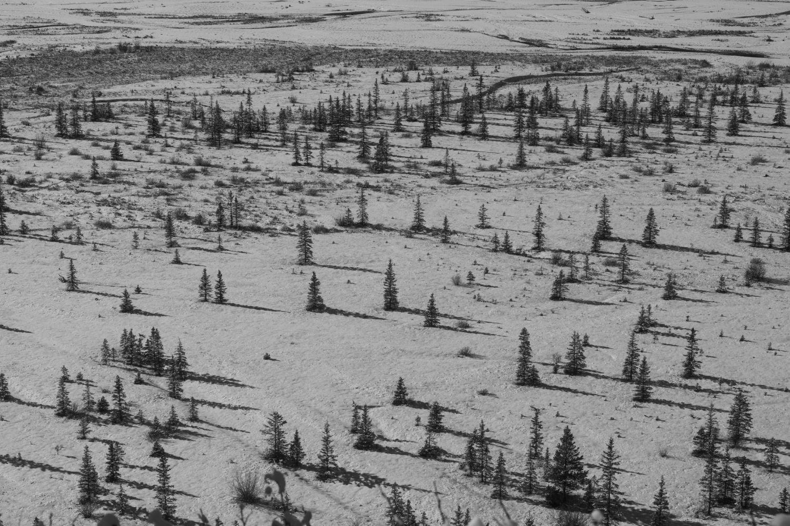

We are excited to announce that Est Rouge has launched two new clubs: a Hiking Club and a Cycling Club!

## Why we started the clubs

The two clubs have two goals:

- To step away from day-to-day work for a while and recharge in nature
- To build connections among members across teams and roles

We want to create a place where moving our bodies helps us reset, and where conversations come naturally with colleagues we rarely get to talk with at work.

## Hiking Club

The Hiking Club plans to explore mountains and scenic landscapes rich in nature.

We will walk at our own pace through nature that changes with every season, from the colors of the trees to the crisp, clear air.

## Cycling Club

The Cycling Club plans to ride through both the city and the countryside.

Even familiar streets look different from a bicycle. We will enjoy all kinds of scenery on two wheels, from the heart of the city to the great outdoors.

## What's next

We plan to share updates on each club's activities here in our NEWS section.

Stay tuned!

*This article is a fictional sample created for technical evaluation. Its contents are not true.*
