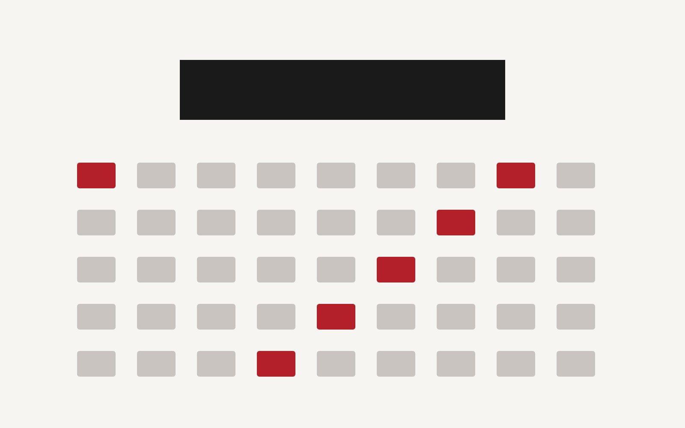

2026年11月に開催される「Web制作カンファレンス 2026」に、Est Rouge のメンバーが登壇します。

## セッション概要

| 項目 | 内容 |
| --- | --- |
| テーマ | 静的サイトジェネレーターと AI による入稿フローの自動化 |
| 日時 | 2026年11月14日（土）14:00〜14:40 |
| 会場 | 東京都内（オンライン同時配信あり） |

当日はデモを交えながら、Markdown ベースのコンテンツ管理と型安全なスキーマ設計について紹介します。ぜひご参加ください。

※ 本記事は技術検証用のサンプルです。
