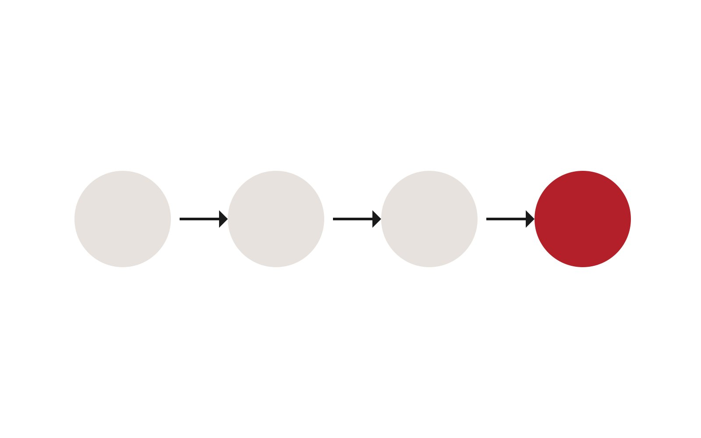

Est Rouge は、コーポレートサイトの運用基盤を見直すため、**Astro**・**GitHub**・**Claude Code** を組み合わせた AI ネイティブなコンテンツ入稿フローの技術検証を開始しました。

## 検証の背景

これまでのノーコードツールによる運用では、更新作業が特定の担当者に集中しがちでした。記事を Markdown ファイルとしてリポジトリで管理することで、変更履歴のレビューや AI による下書き作成・校正を、開発と同じワークフローに乗せることを目指します。

## 今回のスコープ

1. Content Collections による型安全な記事管理
2. 日本語・英語の記事を共通IDで関連付ける仕組み
3. 記事ファイルを追加するだけで一覧・詳細ページが生成される構成

> 次のフェーズでは、Claude Code を用いた入稿支援や CI/CD による自動公開を検証する予定です。

※ 本記事は技術検証用のサンプルです。
