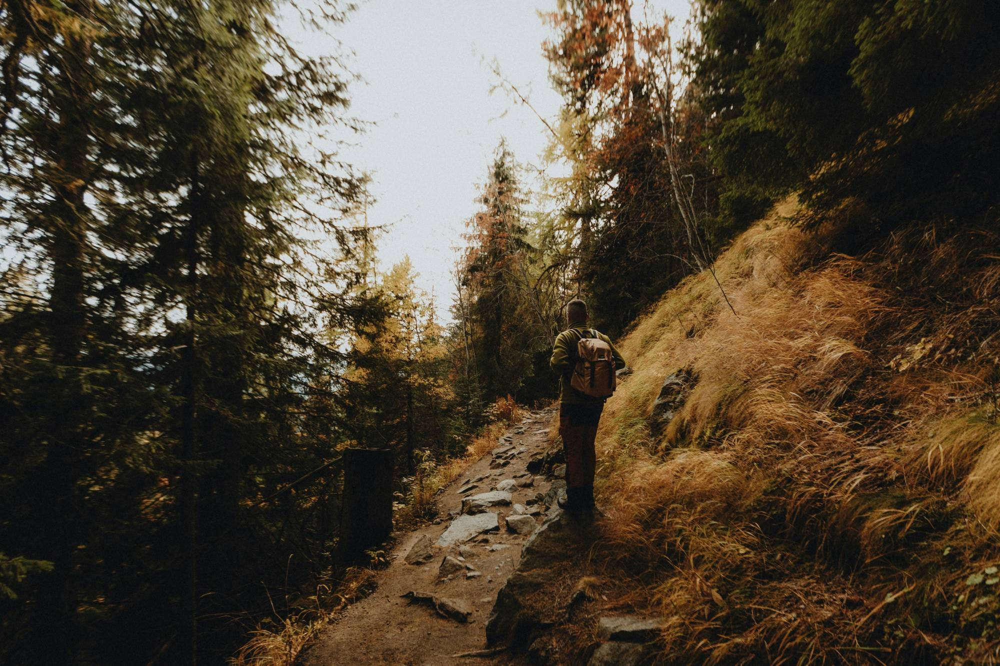
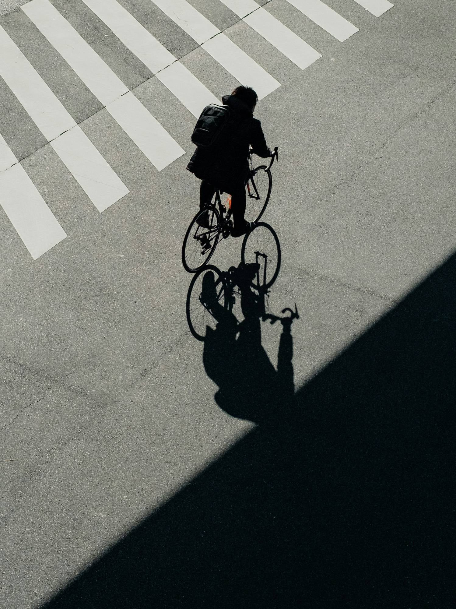
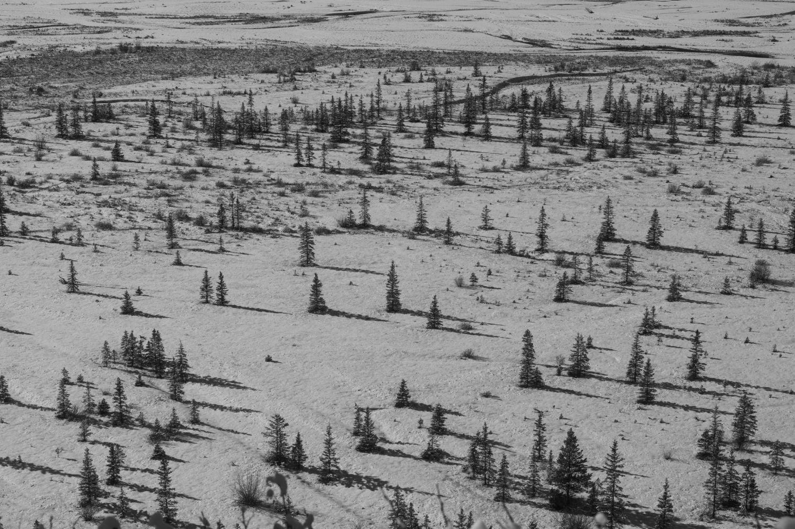

このたび、エストルージュでは新たに「ハイキング部」と「サイクリング部」が発足しました！

## 発足の目的

2 つの部は、次のことを目的として活動します。

- 日々の仕事から少し離れ、自然に触れながらリフレッシュすること
- 部署や役割の垣根を越えて、メンバー同士の交流を深めること

体を動かしながら気持ちを切り替え、普段の仕事ではなかなか話す機会のないメンバーとも自然に会話が生まれる。そんな場を目指しています。

## ハイキング部

ハイキング部では、自然豊かな山々や景色を楽しみながらの散策を予定しています。

木々の色づきや澄んだ空気など、季節ごとに表情を変える自然の中を、自分たちのペースで歩きます。

## サイクリング部

サイクリング部では、街や自然の中を自転車で巡る活動を予定しています。

見慣れた街並みも、自転車で走ると新しい発見があります。街中から自然の中まで、さまざまな景色を自転車で楽しみます。

## 今後について

今後は、それぞれの部の活動の様子もこの NEWS でお届けしていく予定です。

ぜひお楽しみに！

※ 本記事は技術検証用の架空のサンプルです。記載の内容は事実ではありません。
